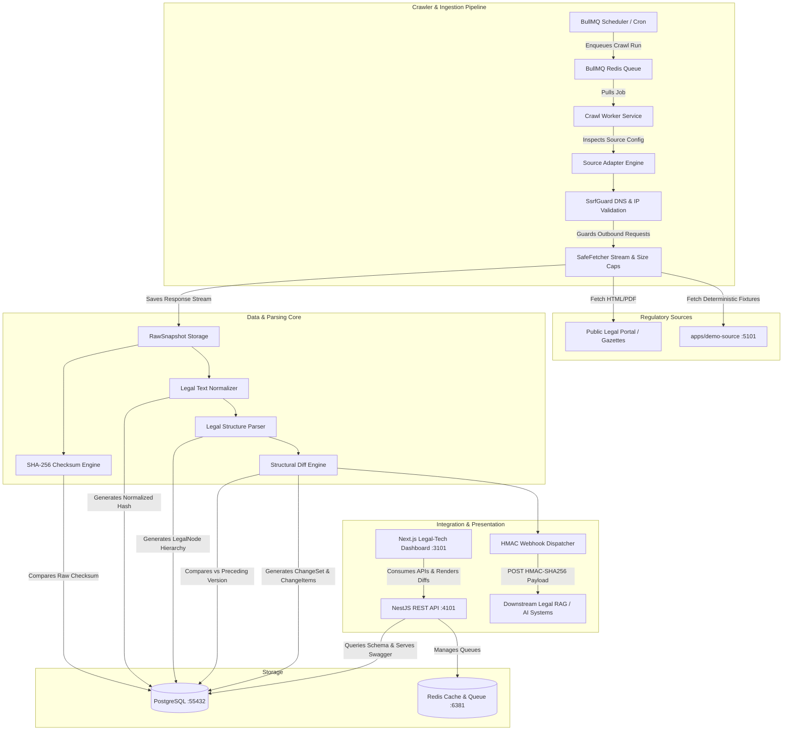

# RegTracker System Architecture

## 1. Executive Summary

**RegTracker** (Regulatory Crawler & Version Tracking System) is an enterprise-grade regulatory intelligence platform designed to monitor legal and government repositories, archive immutable raw snapshots, parse complex legal hierarchies (with first-class support for Vietnamese legal documents: *Phần, Chương, Mục, Điều, Khoản, Điểm*), detect structural additions/modifications/removals without false positives, track regulatory lifecycles, and propagate real-time change sets to downstream Legal AI / RAG platforms via HMAC-signed webhooks and normalized REST APIs.

---

## 2. High-Level System Architecture

---

## 3. Core Modules & Responsibilities

### 3.1. Source Management & Crawler Core (`packages/crawler-core`)
- **Adapter Interface (`RegulatorySourceAdapter`):** Decouples extraction logic from crawler mechanics.
  - `HtmlListingAdapter`: Discovers document URLs from paginated HTML tables or card feeds using CSS selectors.
  - `HtmlArticleAdapter`: Extracts title, document number, authority, publication date, effective date, and substantive body text.
  - `PdfDocumentAdapter`: Extracts structured metadata and text streams from PDF files with strict MIME and byte guards.
  - `MockDemoAdapter`: Deterministic local adapter that fetches synthetic V1/V2 fixtures without internet access.
- **SSRF Defense Guard (`SsrfGuard`):** Enforces strict DNS resolution, validates destination IP ranges (blocks `127.0.0.0/8`, `10.0.0.0/8`, `172.16.0.0/12`, `192.168.0.0/16`, `169.254.169.254`, IPv6 equivalents), and intercepts every redirect step to eliminate DNS-rebinding and redirect exploits.
- **SafeFetcher:** Implements configurable timeouts, exponential backoff, response stream caps (default 10 MB for HTML, 25 MB for PDF), and handles HTTP 304 `Not Modified` conditional requests via `ETag` and `If-Modified-Since`.

### 3.2. Legal Parser Engine (`packages/legal-parser`)
- **Deterministic Normalization:** Strips zero-width characters, non-breaking spaces, control codes, and normalizes consecutive spaces and line wraps while strictly preserving legal punctuation, quotation marks, and statutory lists.
- **Hierarchical Tree Stack Parser:** Analyzes linear legal prose and reconstructs a strict parent-child tree:
  - `DOCUMENT` -> `PART` (*Phần*) -> `CHAPTER` (*Chương*) -> `SECTION` (*Mục*) -> `ARTICLE` (*Điều*) -> `CLAUSE` (*Khoản*) -> `POINT` (*Điểm*).
  - Unclassified blocks and preambles are preserved under `PREAMBLE` or `CLAUSE` order to ensure **zero text loss**.
  - Generates immutable `hierarchyPath` identifiers (e.g. `Chương II > Điều 5 > Khoản 2 > Điểm a`).

### 3.3. Change Detection & Structural Diff Engine (`packages/diff-engine`)
- **Structural Node Matcher:** Compares nodes by type and number (e.g., `Điều 5` in V1 vs `Điều 5` in V2) and checks normalized SHA-256 hashes.
- **Jaccard Similarity Fallback:** For unnumbered or renamed clauses, uses word-level n-gram similarity to accurately classify provisions as `MODIFIED` rather than a false `REMOVED` + `ADDED`.
- **Word-Level Tokenizer:** Computes fine-grained character/word insertions and deletions inside modified nodes for high-contrast UI highlighting.
- **Deterministic Summaries:** Generates exact quantitative tallies (*e.g., "Version 2 introduces 2 modified clauses, 1 added clause, and 0 removed clauses"*) without requiring external LLMs.

### 3.4. Backend API & Workers (`apps/api`)
- Built on **NestJS** and **TypeScript** with Swagger OpenAPI documentation at `/api/docs`.
- **Queue Pipeline:** BullMQ with Redis backing handles asynchronous crawl scheduling, concurrency management, and rate limiting per domain.
- **Relational Integrity:** Prisma ORM on PostgreSQL with strict foreign keys, indexes on `(documentId, versionNumber)`, `documentNumber`, and `hierarchyPath`.
- **RBAC Security:** Role-based access control distinguishing `ADMIN` (source management, manual crawls, webhook maintenance) from `VIEWER` (read-only audit and diff inspection).

### 3.5. Enterprise Web Dashboard (`apps/web`)
- Built with **Next.js 15 App Router**, **Tailwind CSS**, and **Lucide Icons**.
- **Flagship Diff Viewer:** Interactive Side-by-Side and Unified views with word-level insertions/deletions, node hierarchy navigation, and direct "Copy for RAG" JSON export.
- **Comprehensive Monitoring:** Overview dashboard, live crawl status, job queue inspector, webhook delivery logger, and immutable security audit trails.

---

## 4. End-to-End Ingestion Pipeline

1. **Trigger:** A crawl run is triggered via cron schedule, manual admin button, or initial registration.
2. **SSRF Pre-Flight Check:** `SsrfGuard.validateUrl()` verifies the target URL protocol, resolves the host IP, and validates it against blocked private ranges.
3. **HTTP Fetch:** `SafeFetcher.fetch()` makes the request with custom user agent and timeout. If HTTP 304 is returned, the run completes with `NO_CHANGE`.
4. **Raw Snapshot Archival:** The raw HTML/PDF payload is hashed via SHA-256 and stored in `RawSnapshot` with headers and HTTP status.
5. **Deduplication Check:** If the raw checksum matches the latest version, processing stops immediately to avoid redundant parsing.
6. **Normalization & Hash:** Substantive content is extracted and normalized; a `normalizedChecksum` is calculated.
7. **Substantive Comparison:** If the `normalizedChecksum` matches the existing version, format-only changes are logged without incrementing legal version numbers.
8. **Legal Tree Parsing:** If content changed, the hierarchy parser decomposes the document into `LegalNode` records.
9. **Atomic Version Transaction:** Prisma opens an atomic transaction:
   - Creates `DocumentVersion (v+1)`.
   - Creates `LegalNode` hierarchy entries.
   - Computes structural diff against `v`.
   - Creates `ChangeSet` and `ChangeItem` records.
   - Updates document lifecycle state (`EFFECTIVE`, `AMENDED`, etc.).
   - Appends `AuditLog` entry.
10. **Webhook Dispatch:** An asynchronous event (`document.changed` or `document.version.created`) is queued, signed with HMAC-SHA256, and posted to registered endpoints.
