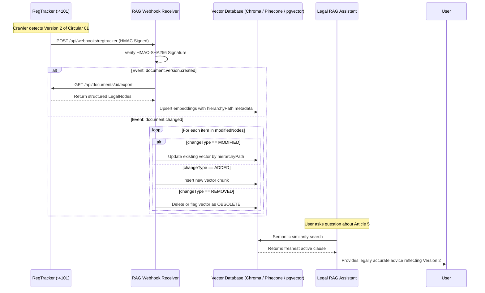

# Downstream Legal RAG Integration Contract

## 1. Overview

**RegTracker** is designed to serve as the ingestion and change detection backbone for downstream **Legal RAG (Retrieval-Augmented Generation)** systems, compliance monitoring platforms, and legal advisory agents.

Legal RAG systems struggle when fed unstructured document blobs or entire statutory codes because retrieval precision degrades. RegTracker solves this by providing:
1. **Pre-chunked, hierarchy-aware legal nodes** (*Điều*, *Khoản*, *Điểm*) mapped directly to their parent chapters and titles.
2. **Real-time webhook notifications** indicating exactly which clauses were modified, added, or removed.
3. **Targeted reindexing**, allowing the vector database to update only changed chunks rather than re-embedding entire multi-megabyte gazettes.

---

## 2. Normalized Document Export Contract

Downstream systems can retrieve full structural trees at any time via:
`GET /api/documents/:id/export`

### 2.1. JSON Payload Specification

```json
{
  "document": {
    "id": "c1f7a092-2b63-4876-92d5-4518337a6ce1",
    "canonicalId": "TT-01-2026-TT-DEMO",
    "title": "Thông tư số 01/2026/TT-DEMO quy định quản lý và giám sát thủ tục điện tử",
    "documentNumber": "01/2026/TT-DEMO",
    "documentType": "THONG_TU",
    "issuingAuthority": "BỘ TÀI CHÍNH",
    "publishedAt": "2026-01-15T00:00:00.000Z",
    "effectiveAt": "2026-03-01T00:00:00.000Z",
    "status": "EFFECTIVE",
    "sourceUrl": "http://127.0.0.1:5101/fixtures/circular-01-v2.html"
  },
  "version": {
    "id": "e283b104-5d98-4c12-876a-394473859da3",
    "versionNumber": 2,
    "normalizedChecksum": "9f83cf5b12a818...65c",
    "publishedAt": "2026-01-15T00:00:00.000Z",
    "detectedAt": "2026-03-01T08:30:00.000Z"
  },
  "nodes": [
    {
      "id": "node-101",
      "type": "CHAPTER",
      "number": "I",
      "title": "QUY ĐỊNH CHUNG",
      "hierarchyPath": "Chương I",
      "orderIndex": 0,
      "content": "Chương I: QUY ĐỊNH CHUNG"
    },
    {
      "id": "node-102",
      "type": "ARTICLE",
      "number": "5",
      "title": "Hồ sơ và thời hạn giải quyết",
      "hierarchyPath": "Chương I > Điều 5",
      "orderIndex": 1,
      "content": "Điều 5. Hồ sơ và thời hạn giải quyết"
    },
    {
      "id": "node-103",
      "type": "CLAUSE",
      "number": "1",
      "title": null,
      "hierarchyPath": "Chương I > Điều 5 > Khoản 1",
      "orderIndex": 2,
      "content": "1. Hồ sơ bao gồm: Bản khai điện tử mẫu số 01 và Giấy chứng nhận xuất xứ hàng hóa (C/O)."
    },
    {
      "id": "node-104",
      "type": "CLAUSE",
      "number": "2",
      "title": null,
      "hierarchyPath": "Chương I > Điều 5 > Khoản 2",
      "orderIndex": 3,
      "content": "2. Thời hạn xử lý hồ sơ là 03 ngày làm việc kể từ ngày nhận đủ hồ sơ hợp lệ."
    }
  ],
  "ragMetadata": {
    "jurisdiction": "VIETNAM",
    "totalNodes": 18,
    "recommendedChunkingUnit": "ARTICLE_OR_CLAUSE",
    "exportedAt": "2026-10-05T03:50:00.000Z"
  }
}
```

---

## 3. Webhook Notification Events

When a regulatory document updates, RegTracker dispatches an event containing HMAC-SHA256 signatures:

- Header: `X-RegTracker-Signature: sha256=<hex_digest>`
- Payload:

```json
{
  "eventId": "evt_98374281",
  "eventType": "document.changed",
  "timestamp": "2026-03-01T08:30:15.000Z",
  "documentId": "c1f7a092-2b63-4876-92d5-4518337a6ce1",
  "versionId": "e283b104-5d98-4c12-876a-394473859da3",
  "changeSetId": "cs_018274a9",
  "summary": "Version 2 introduces 2 modified clauses, 1 added clause, and 0 removed clauses.",
  "modifiedNodes": [
    {
      "hierarchyPath": "Chương I > Điều 5 > Khoản 1",
      "changeType": "MODIFIED",
      "oldContent": "1. Hồ sơ bao gồm: Bản khai giấy mẫu 01.",
      "newContent": "1. Hồ sơ bao gồm: Bản khai điện tử mẫu số 01 và Giấy chứng nhận xuất xứ hàng hóa (C/O)."
    },
    {
      "hierarchyPath": "Chương I > Điều 5 > Khoản 3",
      "changeType": "ADDED",
      "oldContent": null,
      "newContent": "3. Doanh nghiệp thực hiện lưu trữ hồ sơ điện tử tối thiểu 05 năm."
    }
  ]
}
```

---

## 4. Recommended RAG Ingestion Pipeline



---

## 5. Bulk Reindexing Endpoint

To resynchronize all vectors from scratch or refresh indices across an entire corpus:
`POST /api/integrations/rag/reindex`

Request:
```json
{
  "documentIds": ["c1f7a092-2b63-4876-92d5-4518337a6ce1"],
  "targetService": "LEGAL_RAG_ASSISTANT",
  "chunkingStrategy": "BY_ARTICLE"
}
```

Response:
```json
{
  "status": "QUEUED",
  "jobId": "reindex_job_4821",
  "documentCount": 1,
  "queuedAt": "2026-10-05T03:52:00.000Z"
}
```
